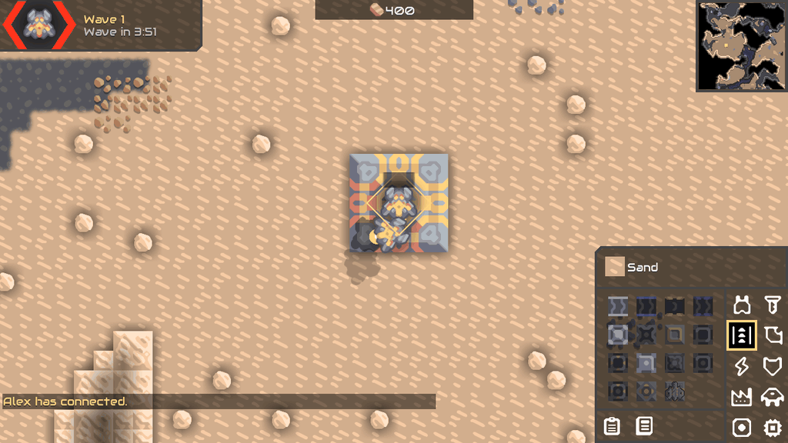

# Rock the Vote

Map voting for Mindustry servers. Install the JAR or add the voting module to your Java plugin.
Panels and messages use the language each player selects in Mindustry.

## Install

Use Mindustry v160 or later and Java 17 or later.

1. Download the plugin JAR from [Releases](https://github.com/hubdustrylab/rock-the-vote-plugin/releases).
2. Stop the server.
3. If you update the plugin, remove the old JAR from `config/mods/`.
4. Put the new JAR in `config/mods/`.
5. Start the server.
6. In the game, run `/rtv`.

To find a map, enter its name in the search box. Press Enter or select the search icon.

## Commands

| Command | Action |
| --- | --- |
| `/rtv` or `/rtv maps` | Open the map list or the active vote. |
| `/rtv map <id>` | Start a vote for a map. |
| `/rtv yes` or `/rtv no` | Set or change your vote. |
| `/rtv status` | Show the vote status. |
| `/rtv lang <code>` | Set the language for this connection. |
| `/rtv help` | Show command help. |
| `/rtv on` or `/rtv off` | Turn voting on or off. Admin only. |
| `/rtv cancel` | Cancel the vote or pending map change. Admin only. |
| `/rtv reload` | Reload settings, messages, and images. Admin only. |

To list map IDs, run `rtv maps` in the server console.
The console also accepts `rtv status`, `rtv on`, `rtv off`, `rtv cancel`, and `rtv reload`.

## Documentation

- [Set vote rules, messages, and images](docs/configuration.md)
- [Build a fork or add voting to your plugin](docs/integration.md)
- [Build and test the project](docs/development.md)

## License

Project code uses [GPL-3.0-only](LICENSE).
