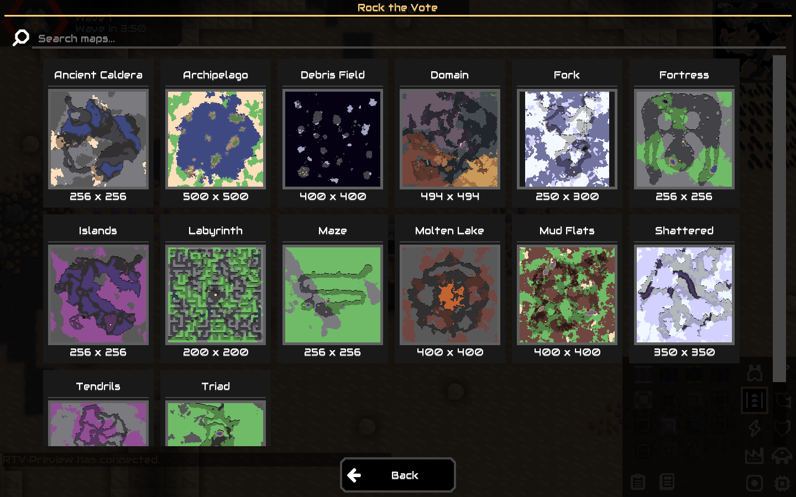
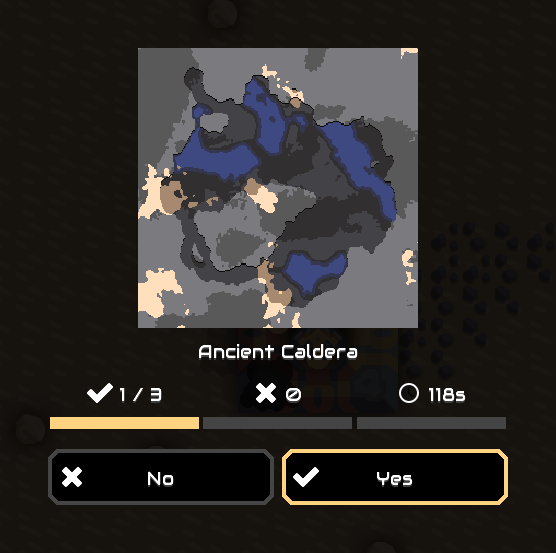

# Rock the Vote

A customizable map voting plugin for Mindustry v160+.
Players choose a map and vote through native server panels.
The map list shows all eligible maps and fits the screen size.
Use the search bar to filter map names. Press Enter or select the search icon.
Supports multilingual messages, custom PNG images, and configurable vote rules.

## Preview

## Build

Requires Java 17 or later.

| Platform | Command |
| --- | --- |
| Windows | `./gradlew.bat build` |
| Linux / macOS | `bash ./gradlew build` |

The plugin JAR is in `build/libs/`.

## Install

1. Stop the server.
2. Copy the plugin JAR to `config/mods/`.
3. Start the server.

The plugin creates its settings in `config/mods/rock-the-vote/`.
See [Configuration](docs/configuration.md) to change vote rules, messages, and images.

## Commands

| Command | Action |
| --- | --- |
| `/rtv` | Open the map panel or active vote. |
| `/rtv map <id>` | Start a vote for a map. |
| `/rtv yes` / `/rtv no` | Cast or change a vote. |
| `/rtv status` | Show the vote status. |
| `/rtv lang <code>` | Set the session language. |
| `/rtv help` | Show command help. |
| `/rtv on` / `/rtv off` | Enable or disable voting. Admin only. |
| `/rtv cancel` | Cancel the vote or pending map change. Admin only. |
| `/rtv reload` | Reload settings, messages, and images. Admin only. |

Use `rtv maps` in the server console to list map IDs.
The console also accepts `rtv status`, `rtv on`, `rtv off`, `rtv cancel`, and `rtv reload`.

## Documentation

- [Configuration](docs/configuration.md)
- [Development](docs/development.md)
